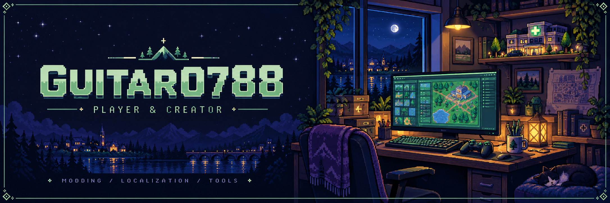

  

  <b>Small projects. New skills. One quest at a time.</b> 
  Exploring game modding, Chinese localization, and practical tools.

  <a href="#-current-quests">Current Quests</a> &nbsp;·&nbsp;
  <a href="#-completed-quests">Completed Quests</a> &nbsp;·&nbsp;
  <a href="#-toolbox">Toolbox</a>

---

## 🎮 Player Profile

Hi, I'm **guitar0788**. I enjoy simulation games, fixing awkward translations, and turning everyday problems into useful little tools.

I learn by building, with **Codex as part of my workflow**. These projects are a work in progress, and every fix is another level gained.

## 🟨 Current Quests

| Quest | What I'm building | Status |
| :--- | :--- | :--- |
| **Project Hospital — Pediatrics Mod** | A pediatric expansion for *Project Hospital*, with compatibility as a core design goal. | **In Development** |
| **Practical Tools** | Exploring small utilities for CAD workflows and repetitive tasks. | **On the Workbench** |

*The pediatrics mod is still in development. Gameplay features and a public release are not yet available.*

## 🟩 Completed Quests

### Boardlike — Simplified Chinese Localization

A community patch focused on missing translations and unclear Chinese text in *Boardlike*.

**Status:** Released · **Language:** Simplified Chinese

[Explore the project →](https://github.com/guitar0788/Boardlike_Chinese-Language-Patch)

## 🧰 Toolbox

  <kbd>Game Modding</kbd> &nbsp;
  <kbd>Localization</kbd> &nbsp;
  <kbd>CAD Workflows</kbd> &nbsp;
  <kbd>GitHub</kbd> &nbsp;
  <kbd>Codex</kbd>

**My approach:** start small, check compatibility, test changes, and keep improving.

---

  <b>Thanks for stopping by. Enjoy your stay!</b> 
  Save your progress. The next quest is always loading.

