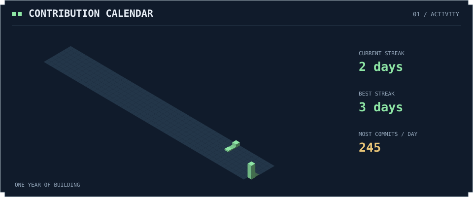
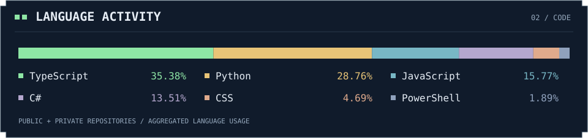
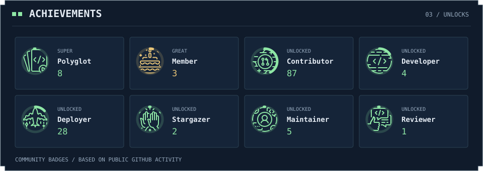

  

  <picture>
    <source media="(prefers-color-scheme: dark)" srcset="https://readme-typing-svg.demolab.com?font=Fira+Code&amp;weight=500&amp;size=22&amp;duration=3200&amp;pause=1600&amp;center=true&amp;vCenter=true&amp;width=720&amp;height=52&amp;lines=Making+mods+for+the+games+I+love.;Building+my+next+Steam+Workshop+project.&amp;color=7EE787">
    <source media="(prefers-color-scheme: light)" srcset="https://readme-typing-svg.demolab.com?font=Fira+Code&amp;weight=500&amp;size=22&amp;duration=3200&amp;pause=1600&amp;center=true&amp;vCenter=true&amp;width=720&amp;height=52&amp;lines=Making+mods+for+the+games+I+love.;Building+my+next+Steam+Workshop+project.&amp;color=238636">
    
  </picture> 
  Game modding · Simplified Chinese localization · Learning by creating

---

## 🎮 Player Profile

Hi, I'm **guitar0788**. I create mods and localization patches for Steam games I enjoy, with an interest in Steam Workshop projects.

My projects start with the games I love and the things I'd like to add or improve.

## 🕹️ My Game Projects

### 🟩 Boardlike — Simplified Chinese Localization

A community patch focused on missing translations and unclear Chinese text in *Boardlike*.

**Status:** Released · **Language:** Simplified Chinese

[Explore the project →](https://github.com/guitar0788/Boardlike_Chinese-Language-Patch)

### 🟨 Project Hospital — Pediatrics Mod

A pediatric mod for *Project Hospital*, with compatibility with the base game, DLC, and other mods as a core design goal.

**Status:** In Development

*Still in development. A public gameplay release is not yet available.*

---

  

  

  

Refreshed daily · Language totals include private repositories · Community achievement badges

---

  <a href="https://github.com/guitar0788/guitar0788/issues/2"><b>🎮 Leave a message in the Workshop Guestbook →</b></a> 
  Say hello, share what you are playing, or suggest a modding idea.  
  <b>Thanks for stopping by. Enjoy your stay!</b> 
  The next quest starts with a game I love.

